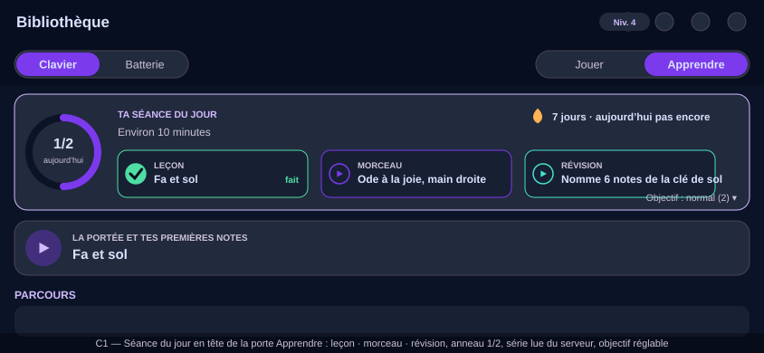

# Design

## Context

Existing building blocks: `CourseCompletion` (completed ids, and passed/best once
`add-music-piece-lessons` lands), the course listing in path order, the play outbox and
`PlaySync` (a delivered session bumps revisions), `Streak` (server-owned, local-day based,
with a recovery offer and an at-risk nudge), the showing-up practice award (once per local
day). The Learn door reserves a slot for this block. See proposal.md — Why.

Constraints: UI never calls services; a provider never invalidates a sibling; coverage
≥ 80 %; four locales; short landscape viewports.

## Goals / Non-Goals

**Goals:**
- A session the learner can finish in ten minutes, built without a new server table.
- A ring that is honest: it reflects what was actually done today.
- One definition of "today": the local day already used by the streak and the award.

**Non-Goals:**
- No minutes-based goal: the app does not measure practice minutes reliably across modes,
  and a count of finished items is honest where a timer is not.
- No server-side session record or cross-device "goal size" (a device setting; revisit if
  learners ask).
- No new reminder: the streak's evening nudge already exists and now has something to point
  at.
- No celebration visuals here (`add-music-motion-and-celebrations`).

## Decisions

### D1 — Composition is a pure function of existing state
`composeDailySession(courses, completion, passedState, todayLedger, goal)` is a pure Dart
function in a host-testable module, tested exhaustively; the notifier only feeds it. Rules:
the lesson item is the first course neither completed nor passed; the piece item is the
first `piece` step not passed in that course or, if none, a passed piece chosen round-robin
by date; the review item is a `readPlay`/`rhythmTap`/`earChoice` block drawn from the most
recently completed unit, run as a one-block mini-lesson. When the path is finished, the
session is piece + review + a replay suggestion.

### D2 — "Done today" is a small local ledger, keyed by local day
A `TodayLedger` persisted through `preferencesServiceProvider`: `{localDay, lessonIds,
pieceStepKeys, reviewKeys}`. Written by the existing notifiers' side effects through a
dedicated listener widget (rule 4): lesson completion, a returned lesson run, a review
finished. Rolling over the local day clears it. Cross-device: the lesson item also reads
as done when the server's completion already includes it; the piece item when the passed
state does; the review stays device-local (it is a two-minute drill).

### D3 — Goal size lives with the player settings, default normal
`DailyGoal { light=1, normal=2, full=3 }` persisted locally; the ring's denominator. The
item list always shows all three so a "light" learner can still do more.

### D4 — The streak is read, never advanced here
The block watches `streakProvider` and shows days + "today covered". It never computes a
streak locally (the one-definition rule in `add-practice-streak`).

### D5 — Completion moment is a state transition, consumed by the motion change
`DailySessionState.completedToday` flips once per local day when done ≥ goal; a listener
widget raises the celebration cue through the existing reward-cue pattern. This change
ships a plain toast; the motion change replaces it.

## Risks / Trade-offs

- [Review drawn from a block the lesson player needs context for] → the mini-lesson wraps a
  single block in the existing lesson player with a synthetic one-block manifest, reusing
  everything.
- [Ledger and server disagree after a device clock change] → the local day is computed from
  the device clock like the streak's `tz_offset`; a disagreement only affects which items
  look done today, never any recorded data.
- [Learner finishes the path] → the composition has an explicit "path finished" mode tested
  on its own.

## Mockups

Wireframes in the app's palette (landscape phone, French copy as the app's French locale would show it); illustrative, not pixel specs. SVG, editable as text, rendered by GitHub.

*C1 — Today's session at the top of the Learn door: lesson · piece · review, the 1/2 ring, the streak read from the server, the goal setting.*

