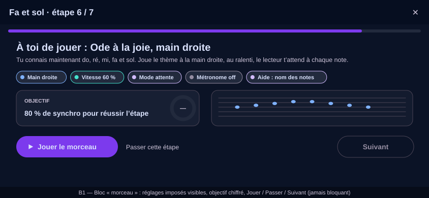
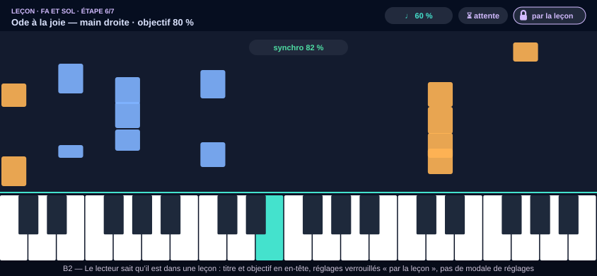
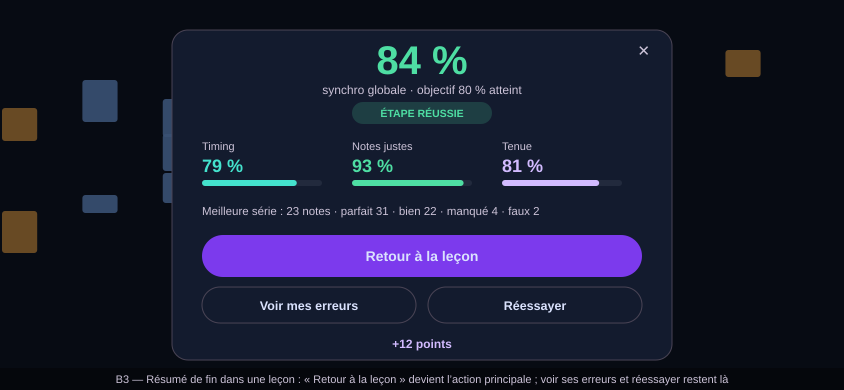

# Design

## Context

Courses are a client-owned, forward-compatible block format stored opaquely server-side
(`music.courses.content`), run by `LessonPlayerScreen`, with completion recorded in
`music.course_progress` (`completed_at`, `play_count`). The score player is opened through
`openScore(context, ref, entry)`, which pre-loads the notation then pushes `PlayerScreen`;
its settings come from `PlayerPreferences` (persisted) and the pre-play setup modal; a
scored run ends in `SessionResult` (overall sync %, per-mode sub-scores, verdict counts) and
the summary modal (replay / retry / close). The `score` block already exists in the format
for *embedded excerpts*; it is not a full piece with a bar to clear. See proposal.md — Why.

## Goals / Non-Goals

**Goals:**
- One block that bridges a lesson to the real player, with imposed settings and an outcome.
- Chains of steps authorable in JSON with no new code per step.
- Passed / best persisted like completion, cross-device, idempotent, never blocking.
- The player stays one player: lesson context is an override layer, not a fork.

**Non-Goals:**
- No locking: a visited step still lets the learner continue (the path guides, it never
  locks — the existing design rule).
- No stars or per-piece best display outside the path (`add-music-piece-stars`).
- No celebration visuals beyond the existing lesson celebration
  (`add-music-motion-and-celebrations`).
- No drum piece lessons; the block is instrument-scoped to keyboard like `playKey`.
- No new audio preview; the lesson shows the piece's title, not an audition.

## Decisions

### D1 — A new `piece` block rather than extending `score`
Alternatives: add `playable: full` and a threshold to the `score` block.
Chosen: a distinct `piece` type. `score` embeds an excerpt rendered inside the lesson;
`piece` leaves the lesson for the full player and comes back with a result. Different
gate, different rendering, different persistence — one type doing both would be two blocks
wearing one name. Older apps skip the unknown type, which is exactly the forward-compatible
behaviour the format promises.

Block shape (all keys client-owned):
`{ "type": "piece", "scoreRef": {"bundled": "ode-to-joy"} | {"catalog": "<id>"},
"hands": "right"|"left"|"both", "speed": 0.6, "waitMode": true, "metronome": false,
"readingAid": "name", "passPct": 80, "prompt": {en,fr,es,it} }`.

### D2 — Imposed settings are a per-run override, never written to preferences
Alternatives: write the lesson's settings into `PlayerPreferences` then restore.
Chosen: `PlayerNotifier` accepts a `LessonContext` (imposed settings + lesson title +
threshold) when the run is opened from a `piece` block; it seeds the run from the context
instead of the preferences and skips the pre-play modal. The gear button still opens the
modal in read-only "imposed by the lesson" mode so the player can see why the hands are
locked. Nothing is persisted, so a crash mid-lesson cannot leave the player's own settings
changed.

### D3 — The outcome is the existing `SessionResult`, judged in the lesson
Alternatives: a new scoring path inside the lesson player.
Chosen: `openScore` returns when the player is left; the summary modal gains a
`backToLesson` action (primary in lesson context) and the last `SessionResult` is already
persisted by the session-summary store. The piece block view reads it, compares
`overallSyncPct` to `passPct`, and marks the step passed or visited. Wait-Mode runs are
classified `wait` by performance scoring and their overall % is the reaction score; the
threshold applies to the overall % whatever the mode, which is what the author chose for
that step.

### D4 — Passed / best are additive columns and fields
`course_progress` gains `passed_at timestamptz` and `best_sync_pct real`;
`RecordCourseCompletionRequest` gains `optional bool passed` and `optional float
best_sync_pct`, `CourseProgress` gains `int64 passed_at_ms` and `float best_sync_pct`.
`passed_at` is set once (first pass), `best_sync_pct` is monotonic (greatest wins) so
devices reconcile without ordering. A course with no piece step never writes them.

### D5 — Content rule: every unit closes with a piece lesson that fits what was taught
Unit 1 (five notes, treble) → "Ode to Joy" right hand only; unit 2 (rhythm) → the same
piece with its real rhythm; unit 3 (full treble staff) → "Twinkle" both phrases; unit 4
(bass clef) → a left-hand accompaniment then hands together; units 5–7 draw from the
catalogue's beginner pieces (Minuet in G for 6/8 and dotted values is intermediate — the
corpus test asserts note range and rhythm figures against the unit's taught set so a
mis-filed piece fails the test, not the learner).

### D6 — Offline
A `piece` step whose score bytes are not cached while offline shows the library's
"not available offline" state and still offers *Next*; nothing in the lesson blocks on
the network.

## Risks / Trade-offs

- [The player's many entry points assume preferences] → the lesson context is read in
  exactly one place (run seeding) and tested for every setting it imposes; the modal's
  read-only mode guards the rest.
- [Catalogue pieces can be moderated away or re-ingested] → `scoreRef.catalog` resolves at
  open time; a missing piece degrades to a visited step with a localized message, and the
  corpus test runs against the seeded catalogue ids.
- [A threshold judged on Wait-Mode reaction % may feel easy] → the chain's last step is
  always free-run at full tempo; authors are told so in the content README.
- [`buf breaking` and old clients] → fields are additive with new numbers; an old client
  ignores them and keeps recording plain completion.

## Migration Plan

Deploy backend first (migration + RPC fields, backward compatible), then seed the new
content, then release the app. Rollback: unpublish the piece lessons (status) — older and
newer apps both keep working; columns stay.

## Mockups

Wireframes in the app's palette (landscape phone, French copy as the app's French locale would show it); illustrative, not pixel specs. SVG, editable as text, rendered by GitHub.

*B1 — A piece block before the run: imposed settings as chips, the numeric target, Play / Skip / Next.*

*B2 — The player in lesson context: lesson title and target in the header, settings locked "by the lesson", no setup modal.*

*B3 — End-of-run summary in lesson context: "Back to the lesson" is the primary action; see mistakes and retry remain.*

