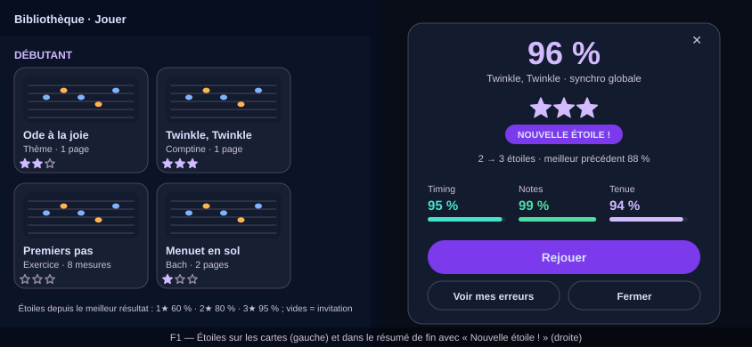

# Design

## Context

Per-piece bests are monotonic server-side and feed `GetLeaderboard` / `GetMyStandings`;
the app batches standings per frame in `MyStandings` for the score cards' rank badges and
refreshes them when a played session is delivered. The session summary knows the run's
overall percentage. The piece step's default pass threshold is 80 %. See proposal.md — Why.

## Goals / Non-Goals

**Goals:**
- Stars that are exactly the stored best, on every surface, with one derivation.
- Zero new storage.

**Non-Goals:**
- No per-hand or per-mode stars; the overall percentage is the one the player knows.
- No configurable thresholds server-side: three constants, stated in the spec, aligned
  with the pass threshold; revisit only if the pass threshold becomes content-configurable.
- No stars for drums pieces in this change (the drum best is the same field; the widget is
  keyboard-only until drum scoring is out of its own change).

## Decisions

### D1 — Stars are derived client-side from the best, thresholds as constants
`starsFor(bestPct) => pct >= 95 ? 3 : pct >= 80 ? 2 : pct >= 60 ? 1 : 0` in a pure module.
Alternatives: computing stars server-side; rejected because the leaderboards already send
the best and a second derived field would be a second source of truth.

The best a piece's stars read is the greater of two records: the server's (D2) and a
**device-local record of the best per piece** (`LocalPieceBests`, written as each scored
run's summary opens). The local record is what a **bundled** piece has — the authored
lesson tunes have no catalogue id and so no board — and what covers the moments between a
run's end and its delivery. Both are monotonic, so the merge is too. On the learning path
and in today's session, a piece lesson's stars read the lesson's own best piece run
(`CourseCompletion.bestPct`, the same runs recorded by `add-music-piece-lessons`), which
needs no manifest to know which score the lesson plays.

### D2 — Reuse `MyStandings`, extend the standing with the best percentage
`MyStanding.best_overall_sync_pct` (optional float, additive, `leaderboard.proto`). The
boards stored only the per-mode sub-scores, so the overall best is now **stored beside
them** (`leaderboard_bests.best_overall_sync_pct`, migration 0034): the ingest raises it
with `GREATEST` on every accepted session, whatever the per-mode ranking decides for the
row, and the standings read returns the max across the two modes. Cards already request
their piece's standing; the star row reads the same map, so a page of cards still costs
one call and refreshes on delivery like the rank badge.

### D3 — The summary compares the run to the previous best
The summary shows the stars this run reached; if the run's stars exceed the stars of the
best known before the run — the local record, or the last standing seen for the piece,
kept across the delivery reset (`MyStandings.known`), whichever is greater — it raises
the new-star moment once, inline: the gained stars pop in, a "New star!" line names the
jump, one light haptic. A best not known yet counts as zero stars, so the first scored run
on a piece always celebrates its stars. The run is then recorded as the device's best.
A measure-range practice run is never scored and opens no summary (`add-measure-range-
practice`), so practice touches no star.

### D4 — Empty stars on unplayed pieces
Three outlined stars, no text: the invitation is the design.

## Risks / Trade-offs

- [Standings only exist for ranked players] → a piece with no standing shows empty stars;
  the first delivered run creates the standing.
- [A practice-range run has no score] → stars are untouched by practice; the summary for a
  practice run shows no star row.

## Mockups

Wireframes in the app's palette (landscape phone, French copy as the app's French locale would show it); illustrative, not pixel specs. SVG, editable as text, rendered by GitHub.

*F1 — Stars on score cards (left) and in the end-of-run summary with the "New star!" moment (right).*

