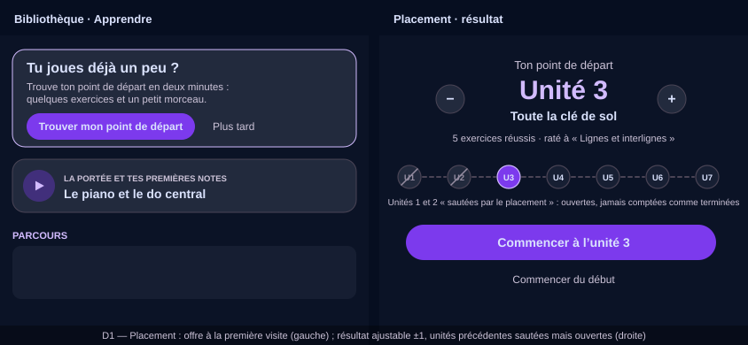

# Design

## Context

Courses are listed with `instrument / track / level / unit` and run by the lesson player,
which already has gated exercise blocks with per-step first-try results (`_flawless`). The
continue card and today's session both pick "the first course neither completed nor
passed" in path order. See proposal.md — Why.

## Goals / Non-Goals

**Goals:**
- Two minutes, skippable, honest: a starting point, not a level.
- Zero app release to tune the questions.
- No interference with badges or completion.

**Non-Goals:**
- No server-side storage of the starting unit (a pointer; see D4).
- No adaptive testing; a fixed short set is enough for seven units.
- No placement for drums.

## Decisions

### D1 — The placement is a course with `track: placement`
Alternatives: a hard-coded quiz in the app.
Chosen: a manifest in the existing format using `nameNote`, `placeNote`, `rhythmTap`,
`earChoice` and one `piece` block, each with a `placementUnit: "u3"` tag — an additive key
the parser keeps for every block, whatever its type (an unknown block keeps its tag too),
as `CourseManifest.placementUnits`, a map by block index: the block union has fourteen
variants and a field on each would be fourteen edits for one optional tag. The listing
excludes the `placement` track from the path (`coursesProvider`) and exposes it through
`placementCourseProvider`. Authors tune it in JSON; the content corpus test asserts every
probe is tagged and the tags cover the units in order.

### D2 — Result = first unit with a miss, from the lesson player's per-step results
The lesson player already records `_flawless[stepIndex]`; the placement run reads it on
finish: the starting unit is the `placementUnit` of the first step not solved first-try,
or the unit after the last probed one when everything was solved — the last unit itself
when nothing follows it. A skipped step counts as a miss. `piece` steps count as solved
when passed. The run ends on the result screen (replacing the player's route), never on a
completion: nothing is recorded against the placement course.

### D3 — Skipped-by-placement is a path display state, not completion
`PlacementState { startUnit?, takenAt? }` persisted locally. The path renders units before
`startUnit` collapsed with a "skipped by placement — open" affordance; their courses keep
their real completed/passed/not-started state underneath. The continue card and the daily
session skip them when choosing "next". Nothing is written to course progress, so no badge
is awarded and nothing needs a server erasure path.

### D4 — Device-local, deliberately
A placement is a two-minute pointer. Syncing it would need an account preference RPC for
a value that a second device re-establishes faster than the sync would be designed. If
learners ask, the pointer can move to the account later without changing this spec's
behaviour.

### D5 — Offer timing
The offer card shows on the Learn door while no placement was taken and no lesson was
completed on this device; it disappears for good once the learner completes a lesson or
takes the placement, and the placement stays reachable from the path header.

## Risks / Trade-offs

- [A learner with one unlucky miss is placed too early] → the result card shows the unit
  and lets them pick the next one up or down before confirming.
- [The `piece` step depends on `add-music-piece-lessons`] → the placement manifest ships
  its piece step last; on an app without the block it is skipped and the result uses the
  exercises alone.
- [Tagging drift as units are renamed] → the corpus test ties tags to existing unit slugs.

## Mockups

Wireframes in the app's palette (landscape phone, French copy as the app's French locale would show it); illustrative, not pixel specs. SVG, editable as text, rendered by GitHub.

*D1 — The offer card at the first Learn visit (left) and the result screen with ±1 adjustment and the earlier units skipped but open (right).*

